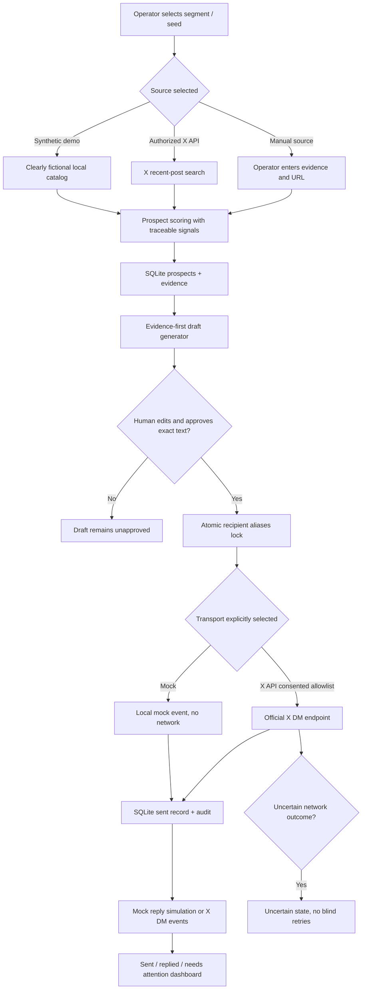

# SignalBridge — system architecture and data flow

## Architecture

## Storage schema

- **campaigns:** user-defined target segment.
- **prospects:** X handle/user ID, bio, source kind, source/evidence, transparent rank reason, optional self-declared consent flag.
- **drafts:** exact message text and state: `draft → approved → sending → sent → replied` (or `uncertain`).
- **send_registry:** per-recipient transport and reservation before outbound call.
- **send_aliases:** unique handle and numeric X ID aliases to prevent duplicate sending across campaigns.
- **activity:** append-only local audit entries for edits, approvals, reservations, sends and simulated/real replies.

SQLite enables durable local tests. For production, migrate to PostgreSQL with transactional uniqueness and a separate worker/outbox. For a platform with many operators, add proper authentication, encrypted OAuth token storage, role authorization, opt-out handling, retention and privacy policies.

## Security invariants

1. **Never auto-send.** Exact message must be approved by an operator.
2. **Never cold-DM.** Real sender checks env allowlist, numeric recipient ID and operator-recorded consent.
3. **Never repeat blindly.** A locked recipient does not auto-reset after ambiguous network results. Stale reservations require manual reconciliation.
4. **Never claim mock equals real.** Every outbound event is labeled `mock` or `x_api`; synthetic people and replies are visibly labeled.
5. **Never store secrets in SQLite or client JavaScript.** Local env only.
6. **No scraping or browser bot.** Only the official X API if authorized.
7. **Local only.** No production login. Restrict server to 127.0.0.1.

## Areas beyond Sprint 1

- Actual end-to-end authenticated X developer account test and handling of real platform 403/429.
- Full OAuth2 PKCE login/refresh + secrets vault for employer-owned accounts.
- Seed-account expansion beyond single current-post query, higher quality embeddings and recency ranking.
- Fully paginated real DM inbox sync and outbound-reply threading, unsubscribe/safety workflow.
- Multi-operator access and deployable secure hosted mode.
